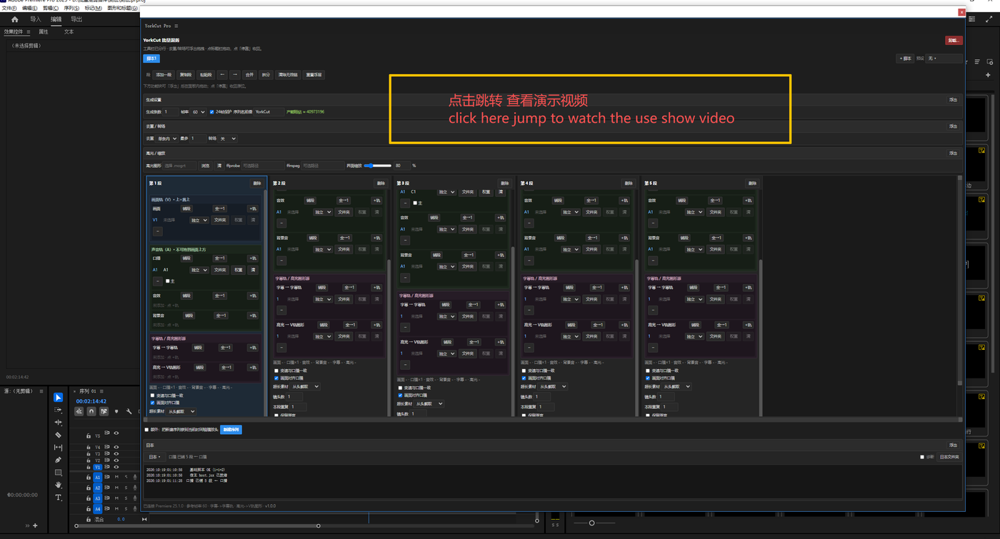

# YorkCut Pro

> Batch editing extension (CEP) for Adobe Premiere Pro: pick clips from per-segment media pools,
> lay out tracks automatically, apply speed changes, and generate a native caption track plus a
> highlight MOGRT — producing several finished sequences in one run.

| | |
|---|---|
| **Version** | 1.0.0 |
| **License** | **AGPL-3.0-or-later** (see [LICENSE](LICENSE)) |
| **Commercial** | **Closed-source distribution requires a commercial license** — 1141673084@qq.com (see [COMMERCIAL.md](COMMERCIAL.md)) |
| **Author** | Luo Yongkang (罗永康) |

> **Dual licensing in one line**: use, modify, distribute and sell freely — but derivative works
> must stay **AGPL-3.0 open source**. To ship a **closed-source** product, buy a commercial license.

**Start here**

> 👆 **Click the cover to watch the full demo** (Feishu doc, Chinese narration)

- 📦 **[INSTALL.en.md](INSTALL.en.md)** — step-by-step install (human + AI agent, with unattended script and verification)
- 📘 **[USAGE.en.md](USAGE.en.md)** — folder layout, caption format, generation flow, logs, FAQ
- 中文文档：[README.md](README.md) · [INSTALL.md](INSTALL.md) · [USAGE.md](USAGE.md)

---

## Features

- **Segments**: each segment has its own media pool; pool (even) or weighted picking
- **Auto layout**: video / voice / SFX / BGM on separate tracks, mute, loop, fades
- **Speed check**: after writing, the real clip length is measured via QE and compared with the plan
- **Captions**: native Premiere caption track (`Sequence.createCaptionTrack` reading SRT)
- **Highlight graphic**: one patched `.mogrt` per caption with the text baked into the template default
- **Caption format**: one `.txt` = one caption/graphic; inner line breaks and blank lines are preserved
- **Fully offline**: no network, no account check, plain-text logs

## Requirements

- Adobe Premiere Pro 23.0+ (25.1+ recommended; that is what this version is tested on)
- Windows 10/11 (64-bit)
- ffmpeg is optional; the installer can download it from the official source

## Install

1. Download `YorkCut-Pro-1.0.0.zip` from the [latest release](https://github.com/yorkloh/yorkcut-pro/releases)
2. Unzip and run `安装到Premiere.bat` (the batch file is ASCII-only and works on any locale)
3. Fully quit Premiere, then reopen it
4. Menu: **Window → Extensions → YorkCut Pro**

Uninstall: run `卸载.bat`, or delete
`%APPDATA%\Adobe\CEP\extensions\com.yorkcut.pro`.

## Highlight template

No `.mogrt` is bundled (Adobe stock templates cannot be redistributed). Put your own template in
`assets\` or pick one in the panel. See `assets/README.md`.

## Language

The panel is Chinese by default and switches to English automatically when the system language is
not Chinese. A small **EN / 中文** button in the bottom-right corner toggles it manually.

## License

**AGPL-3.0-or-later**. Personal, academic and commercial use are allowed, but any derivative work
must be released under AGPL-3.0 as well. Closed-source distribution or closed-source integration
requires a **commercial license** — contact **Luo Yongkang · 1141673084@qq.com**.
See [COMMERCIAL.md](COMMERCIAL.md) · [LICENSE-COMMERCIAL.txt](LICENSE-COMMERCIAL.txt) ·
[COMMERCIAL-LICENSE-TEMPLATE.md](COMMERCIAL-LICENSE-TEMPLATE.md).
